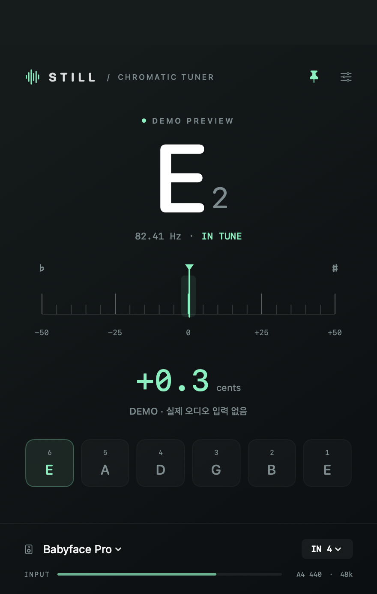

# Still — Guitar Tuner

RME Babyface Pro와 함께 사용하는 macOS 독립형 크로매틱 기타 튜너입니다.



## 다시 다운로드하기

[GitHub Releases](https://github.com/LemonMuscat/still-tuner/releases/latest)에서 `Still-Tuner-1.1.2-macOS-arm64.zip`을 내려받아 압축을 풀고, `Still Tuner.app`을 응용 프로그램 폴더에 넣습니다. GitHub 로그인과 이 비공개 저장소에 대한 접근 권한이 필요합니다.

이 앱 파일은 Apple Silicon(M1 이상), macOS 13 이상용입니다. 로컬 인증서로 서명되어 있으며 Apple 공증은 되어 있지 않습니다. 새 Mac에서는 macOS가 실행을 막을 수 있습니다. 출처를 확인한 다음 시스템 설정 → 개인정보 보호 및 보안에서 실행을 허용하세요. 첫 실행에서 마이크 권한도 허용해야 합니다.

소스는 저장소의 **Code → Download ZIP**으로 받거나 아래 명령으로 복원할 수 있습니다. 소스 ZIP에는 실행 앱이 포함되어 있지 않습니다.

```sh
git clone https://github.com/LemonMuscat/still-tuner.git
cd still-tuner
./scripts/setup-signing.sh  # 새 Mac에서 최초 한 번
./scripts/build.sh
./scripts/test.sh
```

서명 개인 키는 GitHub에 보관하지 않습니다. 새 Mac에서 소스로 다시 빌드할 때는 그 Mac의 서명 인증서를 새로 만듭니다.

## 실행

`build/Still Tuner.app`을 엽니다. 첫 실행에서 macOS 마이크 접근을 허용하세요. 외장 오디오 인터페이스 입력도 이 권한이 필요합니다.

- Babyface/RME 장치를 처음 발견하면 Input 4를 선택합니다. 하단 장치 메뉴와 `IN 4` 메뉴에서 입력 장치 및 채널을 바꿀 수 있습니다.
- 선택한 장치와 채널, A4 기준 주파수, 창 위치, 항상 위 설정을 저장합니다.
- 우측 상단 핀으로 항상 위 표시를 켜거나 끕니다.
- 설정에서 A4를 430–450 Hz로 바꿀 수 있습니다. 기본값은 440 Hz입니다.
- 한 줄씩 연주합니다. 중앙 바늘과 센트 숫자가 ±2 cents 이내이면 녹색입니다. 음이 낮으면 조이고, 높으면 풉니다.
- 아래 여섯 글자는 표준 기타 E2 A2 D3 G3 B3 E4 가이드입니다. 음정 검출 자체는 크로매틱이어서 드롭 튜닝도 표시합니다.
- 종료는 ⌘Q 또는 창 닫기입니다.

## 원음과 다른 오디오 앱

이 앱은 **입력만 읽으며 오디오를 출력하지 않습니다.** 기타 소리를 듣는 경로는 현재 TotalMix의 하드웨어 모니터링 또는 Cubase 모니터링을 그대로 사용합니다. 원음에 EQ, 게인, 이펙트, 리샘플링 결과를 적용하지 않으며, 재출력에 의한 이중 모니터링/피드백도 만들지 않습니다.

Core Audio HAL의 출력 I/O를 비활성화합니다. 시스템 기본 입력/출력, 기기 샘플레이트, 기기 버퍼 크기, 독점 모드, TotalMix 설정을 변경하지 않습니다. Cubase와 동시에 같은 입력을 읽을 수 있도록 설계했습니다. 다른 앱이 장치를 독점하면 접근을 강제하지 않고 연결을 재시도합니다.

장치를 분리하면 해당 UID를 기다립니다. 다른 마이크로 임의 전환하지 않습니다. 재연결, 샘플레이트 변경, 절전 복귀, 콜백 중단에 대해 재연결을 시도합니다. 컴퓨터가 잠자는 동안은 측정하지 않으며, 잠에서 깬 뒤 재개합니다. 녹음 파일 저장이나 네트워크 전송은 없습니다.

## 개발

macOS와 Xcode Command Line Tools가 필요합니다. 현재 빌드한 앱은 Apple Silicon용이며 앱 전용 로컬 인증서로 서명합니다. 공증된 배포용 앱은 아닙니다.

```sh
./scripts/build.sh
./scripts/test.sh
```

약 85 ms 길이의 최신 입력을 30 Hz로 분석합니다. 피치 검출은 다운샘플된 **분석용 복사본**의 YIN이며 오디오 출력 경로가 없습니다. 실시간 콜백은 미리 할당한 입력 버퍼와 고정 크기 링 버퍼에만 접근하며, 분석은 별도 직렬 큐에서 수행합니다. 링 버퍼가 사용 중이면 콜백은 대기하지 않고 해당 블록을 건너뜁니다.

합성 테스트에는 44.1/48/96/192 kHz에서 기타 저음/고음, 강한 배음, 무음, DC, 잡음이 포함됩니다. 테스트 결과는 분석 알고리즘 검증이며 실제 기타와 인터페이스의 종단 지연이나 장시간 안정성을 보증하지 않습니다. 실제 연주, Cubase 동시 사용 및 장시간 연속 동작은 별도 확인이 필요합니다.

화면 검증용 실행(실제 오디오를 사용하지 않음):

```sh
open "build/Still Tuner.app" --args --demo
```

## 디자인 참고

큰 음정 표시, 높은 명암 대비, 중앙 튜닝 강조는 [Peterson StroboStomp HD](https://www.petersontuners.com/products/stroboStompHD/) 같은 전용 튜너의 가독성 중심 접근을 참고했습니다. Still의 구현은 자체 바늘형 UI이며 Peterson 스트로브 알고리즘을 구현한 것은 아닙니다.

## 1.1 업데이트 — 미니 모드와 기준음 비교

상단의 위쪽 화살표로 미니 모드를 켜고, 아래쪽 화살표로 전체 화면을 펼칩니다. 미니 모드는 약 380 × 310 pt의 콘텐츠 영역에 음 이름, 센트, 주파수, 바늘과 현재 입력/기준음을 남깁니다. 선택한 모드는 다음 실행에도 유지됩니다. 입력 변경은 전체 화면에서 합니다.

A4 기준음은 두 모드 모두 하단에서 바로 바꿀 수 있습니다. 다른 튜너와 비교할 때는 A4를 동일하게 맞추고, 상대 튜너의 음별 오프셋도 확인하세요. C♯와 D♭는 이명동음입니다.

예를 들어 입력이 139.28 Hz이면 A4=440 Hz 기준 C♯3 +8.5815 cents, A4=441 Hz 기준 +4.6513 cents입니다. 두 기준의 차이는 `1200 × log2(441/440) = 3.9302 cents`이며 검출 오차가 아닙니다. 기준음 변경은 표시 기준만 바꾸며 오디오 신호는 그대로입니다.

피치 검출의 소수 샘플 보간을 정규화 차분 곡선에서 원래 차분 곡선으로 수정해 작은 샤프 편향을 줄였습니다. Hz와 cents도 동일하게 평활화한 주파수로 계산하므로 서로 다른 순간의 측정값을 보여주지 않습니다.

624개 정상상태 합성 신호(55 Hz 부근부터 약 1.06 kHz, 44.1/48/96/192 kHz, 배음·시작 위상·디튠 포함)에서 수정 전 최대 절대 오차 1.5313 cents / 평균 부호 오차 +0.1843 cents, 수정 후 0.3227 cents / +0.0040 cents를 확인했습니다. 이는 해당 합성 테스트 집합의 결과이며, 실제 기타 전체에 대한 정확도 사양이나 Helix와의 동시 비교 인증은 아닙니다. 피킹 직후 변하는 음정, 배음 구성, 현의 비조화성, 두 앱의 표시 갱신 시점 때문에 순간 수치는 다를 수 있습니다.

## 1.1.1 — 플랫 표기

음 이름은 전체/미니 모드 모두 Db, Eb, Gb, Ab, Bb로 표시합니다. 하프다운 튜닝의 개방현은 Eb2 Ab2 Db3 Gb3 Bb3 Eb4입니다. 기본 기준음은 A4=440 Hz이며, 하프다운 튜닝을 위해 기준음을 낮출 필요는 없습니다. 음 이름 표기만 바꾸므로 주파수 검출과 cents 계산에는 영향이 없습니다.

## 마이크 권한 유지와 빌드 서명

임시(ad-hoc) 서명 대신 이 Mac의 앱 전용 인증서로 서명합니다. macOS가 앱을 식별하는 조건은 번들 ID와 서명 인증서 지문으로 고정됩니다. 첫 전환 시 한 번 허용한 뒤 같은 인증서를 유지하면 후속 빌드도 동일한 앱 신원으로 인식할 수 있습니다.

최초 개발 환경 설정은 `./scripts/setup-signing.sh`입니다. 전용 키체인과 제한된 파일 권한(현재 사용자만 접근)을 사용하며, 인증서 신뢰는 사용자 영역의 코드 서명 용도로 제한합니다. 인증서 등록 시 macOS 인증이 필요할 수 있습니다. 마이크 권한 데이터베이스, SIP, 웹 인증서 신뢰는 변경하지 않습니다.

이후 `./scripts/build.sh`는 항상 `scripts/sign.sh`를 통해 같은 인증서로 서명합니다. 인증서가 없으면 임시 서명으로 자동 후퇴하지 않고 중단합니다. 키는 `~/Library/Application Support/StillTuner/Signing`의 전용 키체인에 보관하며, 프로젝트 또는 앱에 개인 키를 포함하지 않습니다. 서명 동안만 해당 키체인을 검색 목록에 추가하고 원래 목록으로 복원합니다. 해당 Signing 폴더를 지우거나 인증서를 바꾸면 권한을 다시 요청할 수 있습니다.

이 서명은 로컬 사용용이며 Apple Developer ID 서명/공증은 아닙니다.
